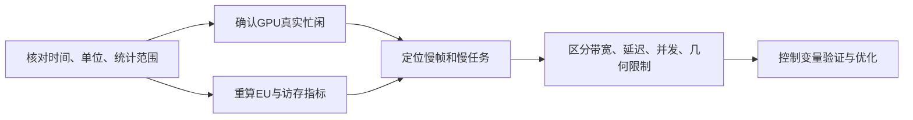

建议把这项工作组织成一条证据链：**计数口径正确 → 找到实际变慢的阶段 → 判断限制来自哪里 → 用控制变量实验验证 → 再决定优化方向。**

目前最优先的是查清 `dt` 和 `GPU Duration`，因为它们会同时影响第1条的活跃率、第3条的带宽，以及部分加权结果。之后重点深入第2、3、5条的联系，最后评估几何处理是否值得优化。

开始计算前，先在内部给每个使用的指标补齐这些信息：**原始名称、单位、累计值还是区间值、统计范围、百分比分母、采样时间含义、无效值规则**。下面的公式是建议的统计方法；如果缺少原始分母，就明确保留近似和不确定性，不要补成一个看似精确的结果。

1. **针对“GPU 空闲65%”：需要证明执行时间线上确实存在这些空隙。**

   首先查生成 `dt` 的代码或公式。重点核对：

   - 它是不是**同一 counter 轨道**相邻有效采样的时间差？不能将不同指标的导出行混排后相减。
   - 当前数值描述前一个采样区间，还是后一个区间？时间戳表示采集开始、结束，还是结果写出时间？
   - `dt` 是在筛选 Compute 样本之前计算，还是之后计算？如果先筛选再求时间差，会把中间没有选中的时间也算进去。
   - GPU Duration 是本区间时长、累计时长，还是经过换算的值？是否与 `dt` 覆盖完全相同的区间？
   - 若时长由 cycles 换算而来，使用的时钟域、频率和跨核心汇总方法是否正确？

   同时检查重复记录、采样缺口、计数重置和单位换算。缺失值不能直接当作零；已经是区间增量的数值，也不能再求一次差分。

   **建议计算两个独立口径的活跃率。**

   当 GPU Duration 确认为各个不重叠采样窗口内的 GPU 活跃时长时，计算：

   \[
   A_{\text{counter}}=
   \frac{\sum_i GPUDuration_i}{\sum_i \Delta t_i}
   \]

   再利用实际 GPU 执行事件计算：

   \[
   A_{\text{event}}=
   \frac{\text{窗口内GPU执行区间并集的长度}}
   {\text{窗口墙钟时长}}
   \]

   后一个分子要用执行区间的**并集**，避免重叠任务重复计时；也要确认事件标记的是执行，而不是从提交到完成的整个驻留过程。GraphicsProfiler 的 GPU and Driver Events 可辅助关联提交、依赖和执行。[华为事件分析说明](https://developer.huawei.com/consumer/cn/doc/Tools-Guides/gpu-and-driver-events-0000002111866001/)

   接着统计：空隙总时长、空隙次数、空隙时长中位数/P95，以及它们在帧内的位置。

   **根据时间线区分原因：**

   - **GPU 空隙期间没有新任务提交**：检查 CPU 渲染线程和工作线程是在执行、等待调度，还是等待资源。可能是 CPU 提交不足。
   - **已经提交，但依赖尚未满足**：检查 fence、semaphore 和资源依赖，可能是同步限制。
   - **任务已具备执行条件却迟迟未执行**：再调查调度、其他进程竞争和功耗状态。
   - **GPU 按固定节奏完成后等待**：检查限帧、呈现和缓冲区获取。
   - **执行时间线基本连续，派生 Active 仍接近35%**：优先检查公式、统计范围和工具计量。

   可以额外计算“提交到开始执行”的延迟，但它同时包含排队和依赖等待，不能直接命名为“驱动开销”。同样，CPU 在等待 GPU 完成，也不自动说明 CPU 是瓶颈。[APA 帧耗时分析](https://developer.android.com/android-performance-analyzer/analyze/frame-times)

   **验证实验**：在同镜头、相近温度下，用两档受支持的采样周期重复采集，并比较少量核心指标与完整计数器集合。如果派生 Active 随采集配置明显变化，而实际执行时间和成绩基本不变，计量问题的可能性会增加。

   后续优化分别对应 CPU 提交、同步依赖、帧节奏、调度或采集配置。必须先完成这一步分类。

2. **针对“EU 执行低、数据停顿高”：需要分清等待发生在哪一层，以及是否拖慢了关键任务。**

   先校正加权方法。华为这些 EU 百分比的分母是 Shader Core 活跃时间；`EU Stall by Data` 包含等待纹理采样或数据加载。[华为计数器定义](https://developer.huawei.com/consumer/cn/doc/Tools-Guides/performance-counter-0000001807370140/)

   对任意比例，通用汇总方法是：

   \[
   p_i=\frac{X_i}{N_i}
   \quad\Rightarrow\quad
   P=\frac{\sum_i X_i}{\sum_i N_i}
   =\frac{\sum_i p_iN_i}{\sum_iN_i}
   \]

   **权重必须是这个指标自己的分母。**如果定义按时间统计，就用对应活跃时间；若实际实现按周期统计，就需要相应周期量。频率变化时，两种权重可能不同。

   对 EU 指标，建议优先取得真实的 Shader 活跃分母 \(H_i\)。只有确认统计范围和汇总方式严格对应，才能用：

   \[
   H_i=GPUDuration_i\times ShaderCoreActive_i
   \]

   这里百分比按0～1使用。如果一个指标按核心平均，另一个按全 GPU 汇总，这个乘法不一定成立。

   重新计算执行、停顿、数据停顿的总体比例，并在同分母、同样本条件下计算：

   \[
   数据停顿占全部停顿比例=
   \frac{\sum_i H_i\,DataStall_i}
   {\sum_i H_i\,Stall_i}
   \]

   **然后把这些比例放回实际耗时中。**按相同镜头或相同任务，联看：

   - GPU 实际耗时；
   - EU 数据停顿；
   - 每帧或每任务外存读写量；
   - 纹理单元活动；
   - 并发线程束数量；
   - GPU、DDR 频率。

   这些组合可以帮助区分四类候选原因：

   - **数据停顿高，外存持续高吞吐且出现背压**：优先检查外存吞吐限制。
   - **数据停顿高，外存并不繁忙，着色器存在连续依赖采样**：优先检查访问延迟和依赖链。
   - **数据停顿高，同设备上并发线程束偏少，并伴随较高资源占用**：检查寄存器、共享资源或任务规模是否限制了并发。
   - **纹理单元持续繁忙，外存压力却不突出**：检查纹理采样、过滤、格式或片上数据通路。

   后三类都可能出现“带宽没有打满，EU 仍然一直等数据”。高通公开指南也明确区分带宽限制和并发不足导致的延迟限制，但其具体阈值不能套用华为。[高通优化指南，4.4节](https://docs.qualcomm.com/doc/80-NB295-11/80-NB295-11_REV_C_Qualcomm_Snapdragon_Mobile_Platform_Opencl_General_Programming_and_Optimization.pdf)

   **优化方向取决于分类结果：**减少外存搬运、改善访问局部性、缩短依赖链、降低资源占用，或减少昂贵采样。寄存器压力需要结合实际编译结果分析；仅看中间语言的静态统计，还不足以确定硬件上的驻留情况。[Android Shader 分析](https://developer.android.com/agi/frame-trace/shader-performance)

   不要把“60% stall”直接换算成“能减少60%帧时间”。多个执行单元的等待可能重叠，等待也可能被其他工作覆盖。

3. **针对“纹理读占90%、带宽接近上限”：需要同时研究流量来源、缓存行为和持续吞吐。**

   先确认字节数表示什么：是物理外存流量还是逻辑访问量、压缩前还是压缩后、全 GPU 总量还是按核心平均。也不要自行假设“L2读取＋TU读取＋LSC读取＝总读取”，这些字段可能描述同一流量的不同路径。

   **建议重算四类数据。**

   第一类是流量来源：

   \[
   TU读取占比=
   \frac{\sum_i B_{\mathrm{TU},i}}
   {\sum_i B_{\mathrm{Read},i}}
   \]

   前提是 TU 读取确实属于同范围的总读取。

   第二类是带宽和每帧工作量：

   \[
   平均墙钟带宽=\frac{\sum_i B_i}{\sum_i\Delta t_i}
   \]

   \[
   平均活跃期带宽=\frac{\sum_i B_i}{\sum_iGPUDuration_i}
   \]

   \[
   每帧读写量=\frac{\sum_i(B_{\mathrm{Read},i}+B_{\mathrm{Write},i})}
   {\text{对应窗口实际渲染帧数}}
   \]

   第二个公式必须等 GPU Duration 校准后再解释。分母中的帧数也不能直接用屏幕刷新次数代替。

   如果原始字段已经是 Bytes/s，应按真实时间积分恢复字节量，不能再除一次时间。APA 的 Adreno 读取、写入总量轨道就是速率形式。[APA 内存分析](https://developer.android.com/android-performance-analyzer/analyze/mem-efficiency)

   第三类是缓存总体未命中率：

   \[
   MissRatio=
   \frac{\sum_i MissRequests_i}{\sum_i Requests_i}
   \]

   请求计数不可得时，可以保留“时间加权的 miss 曲线均值”，但不能把它称为总体请求未命中率。**也不能直接用 Texels Sampled 代替缓存请求数量**，它们的计数粒度未必一致。

   第四类是吞吐持续性：除峰值外，记录相同长度窗口下的中位数、P95/P99，以及高吞吐持续多久、是否与慢帧和外存等待重合。可变采样间隔下，“样本p99”和“时间p99”不是同一个统计量。

   **接下来理清三层关系：**

   - **纹理缓存 miss → 是否进入外存？**继续看 L2 和外存流量。纹理缓存 miss 上升而外存没有相应增长，说明后续缓存可能吸收了相当一部分请求。
   - **外存流量增加 → 是否导致变慢？**同镜头下比较每帧字节数和任务耗时，避免被帧率变化干扰。
   - **高吞吐 → 是否达到持续服务能力？**核对实际 DDR 状态、读写合计和其他模块竞争，不能仅和宣传峰值比较。

   理论带宽可由“有效传输率×总数据位宽÷8”估算，但这是上界参考。有效传输率已经包含双沿传输时，不要再额外乘一次2。

   **资源层面要继续追“到底读了什么”。**可以分为素材纹理、G-buffer/历史帧等中间图像，以及 Compute 中间结果。对应检查尺寸、格式、压缩、mipmap、过滤方式和读写次数。

   优化方向随资源类型变化：

   - 素材纹理：压缩、mipmap、采样方式和访问局部性。
   - 中间图像：减少往返读写、检查格式和阶段组织。
   - 相同工作负载下某平台额外搬运数据：调查缓存复用、渲染目标保存/加载、subpass 和驱动处理路径。GraphicsProfiler 的优化提示也包含部分 attachment、load/store 和 loadtile 检查。[华为优化提示](https://developer.huawei.com/consumer/cn/doc/Tools-Guides/errors-warnings-hit-0000002509320671/)

   若实验环境支持独立频率控制，可固定 GPU 条件测试 DDR 频率敏感性。但“提高 DDR 后变快”只证明对内存系统敏感，延迟改善同样可能起作用，仍需结合持续吞吐和背压判断。

4. **针对“几何被大量剪裁/剔除”：需要把事件比例转换成实际处理成本。**

   首先分别记录：

   - 每帧输入或组装图元数量；
   - 每帧剪裁事件数量；
   - 每帧剔除事件数量；
   - 每帧可见图元数量；
   - 对应 binning/顶点处理任务的实际耗时。

   如果分母定义一致，分别用总计数计算剪裁率和剔除率。不要混用“比例中位数之和”“逐样本相加后的中位数”和“总计数比”。

   还要确认剪裁和剔除是否互斥。剪裁后的图元可能仍有可见部分，并可能产生新图元，因此不能自动把它们相加当作“完全无效的提交比例”。

   **真正需要理清的是这条关系：**

   **提交了多少几何 → GPU 实际处理多少 → 花了多少时间 → 是否让后续渲染等待。**

   对同镜头的重复运行、或两台设备对应阶段，观察：

   - 图元数量增加时，binning 实际耗时是否同步增加？
   - 相似图元规模下，华为是否额外变慢？
   - binning 完成之前，后续任务是否被阻塞？
   - 几何耗时增加能解释多少实际帧时间差异？

   跨设备还要核对应用层工作量，例如绘制调用、实例数量、索引数量和 pass 数。硬件处理图元计数不同，不一定代表应用提交了更多几何。

   可以计算“每百万处理图元对应的 binning 耗时”作为同设备、同类任务的辅助指标。但顶点着色复杂度、实例化和阶段重放不同都会改变这个值，所以不能把它当成跨 GPU 的纯硬件效率。

   **不同结果对应不同方向：**

   - 剔除率高，但几何耗时低且稳定：暂不优先优化。
   - 输入规模大，几何耗时随之增长且阻塞关键路径：检查可见性判断粒度、LOD和几何复杂度。
   - 工作规模相近，某设备几何阶段明显更慢：继续区分顶点着色、几何读取和前端处理压力。
   - 几何阶段变快，整帧没有改善：可能被其他阶段覆盖，或瓶颈已经转移。

   当前的15.3%活动比例只能提供阶段线索，不能直接作为可回收帧时间。

5. **针对“Compute 是访存重灾区”：需要定位到具体 dispatch，并计算它对每帧的贡献。**

   第一步是重新分组。`Compute Active > 0` 只能筛出“包含 Compute 的窗口”。即使任务顺序执行，一个采样窗口也可能同时覆盖 Compute 和 Rendering。

   建议结合执行事件分为 Compute 主导、Rendering 主导、混合边界三类。**不能用 Compute 活跃比例乘窗口总流量，估算 Compute 流量**，因为不同阶段的流量速率并不相同。

   如果任务短于采样区间，现有 trace 可能没有足够分辨率做独占归因。此时应保留窗口层面的结论，或补采帧级数据。只选完全落在 Compute 内的窗口，还会偏向长任务；它们适合研究机制，不一定代表全部 Compute。

   对每个主要 Compute 任务，建议在内部记录：

   - 任务标识、每帧出现次数；
   - 实际执行耗时和帧内位置；
   - dispatch 网格及工作组尺寸；
   - 输入输出资源及其尺寸、格式；
   - 能可靠归属的读写字节数；
   - 数据停顿、缓存、纹理通路和并发情况。

   重点计算“每次任务耗时”“每帧累计耗时”“每次任务或每帧字节数”。任务规模不同，再考虑按逻辑 invocation 或该任务实际输出像素数归一化。后处理可能采用低分辨率，不能把全部任务一律除以最终屏幕像素数。

   **先按耗时贡献排序，再分析 stall。**对于存在重叠的任务，要检查它们在帧关键路径上的位置，不能简单相加各任务时间。

   SNL 的优先候选包括体积云 ray-march、FFT Bloom、粒子模拟和草的分布/LOD；官方也说明它不使用异步计算。[SNL 引擎说明](https://support.benchmarks.ul.com/support/solutions/articles/44002528077-steel-nomad-light-engine)

   对这些候选分别提出可验证的问题：

   - **云任务**：时间是否主要随采样工作和依赖链增长？是否伴随低并发及高数据等待？
   - **Bloom任务**：是否存在多个昂贵阶段或较多中间图像往返？主要压力落在纹理、加载/存储还是外存？
   - **粒子和草任务**：实际任务规模有多大？是否存在不连续访问、较大的资源占用，或只在某些镜头明显增加？
   - **任务之间**：前一阶段的结果是否导致后一阶段等待？同步边界附近是否伴随明显搬运或空隙？

   与一加比较时，优先对齐相同效果、任务规模和资源，比较**阶段耗时、每帧读写量、相对整帧的耗时贡献**。两个平台的指令条数和 stall 百分比不宜直接相减排名。

   如果华为同阶段搬运的数据明显更多，先查渲染路径和数据复用；如果流量相近但耗时更长，则继续检查延迟、纹理处理能力、并发、频率和编译结果。两种情况都需要进一步证据，才能指定到具体软硬件原因。

对你当前掌握的 SNL 二进制和 trace，建议按三轮推进：

- **第一轮，用现有数据完成口径核验。**查清 `dt`、Duration、累计/区间值及权重；重算活跃率、每帧流量和总体比例。得到“哪些结论可靠、哪些暂不能解释”的清单。
- **第二轮，补齐定位证据。**对齐两端镜头和热状态，重复采集，加入可用的 GPU 执行事件、CPU 提交、GPU/DDR频率及外存等待；定位最耗时的几个任务。先确认采集本身没有明显改变表现。
- **第三轮，做有条件的修改实验。**有权限和工具支持时，在回放、独立复现或研发版本中，每次只改变一个因素。检查目标任务耗时和整帧耗时是否都改善，以及实际工作量和输出是否保持一致。

修改 shader、工作组、资源尺寸或关闭效果，应作为定位实验处理；改变了标准负载的结果不能与正式 SNL 成绩混报。回放也可能改变缓存、频率和前序依赖，需要回到真实运行验证。

最后，统计时以**重复运行**作为重复试验。单条 trace 中上万个相邻采样并不等于上万个独立样本。你最终需要形成的证据，应能回答：**哪个任务变慢、额外成本有多大、哪种机制能解释它，以及改变相应因素后是否真的减少了耗时。**
